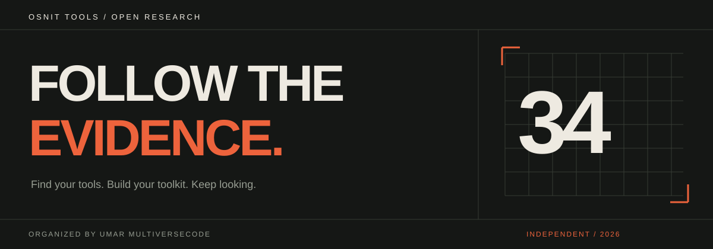

<p align="center"></p>

<p align="center"><strong>34 categories · 177 repository entries · 1,846 unique resource links</strong></p>
<p align="center"><a href="#explore-the-directory">Explore the directory</a> · <a href="#run-the-website">Run locally</a> · <a href="CONTRIBUTING.md">Contribute</a> · <a href="ATTRIBUTION.md">Credits & licenses</a></p>

# OSNIT TOOLS

A considered directory for open-source research. Find a useful starting point across usernames, public records, imagery, archives, domains and more. Organized by [Umar MultiverseCode](https://github.com/Umar-MultiverseCode), with original creators credited at every step.

**Choose a direction. Find your tools. Follow the evidence.**

This is a directory and independently written website. Tool implementations remain in their original repositories, with their original licenses. The catalogue does not claim that every listing is installable, available, free or tested.

## The website

An editorial charcoal-and-orange interface with rectangular controls, strong typography and responsive layouts. No external font downloads, trackers, accounts or runtime services.

- Search by tool name, keyword, creator or category.
- Combine 34 category filters with repositories, websites, Telegram resources, videos and extensions.
- Switch between grid and list views, inspect source credits, and copy repository clone commands.
- Save a personal toolkit in your browser and export it as JSON.
- Share filtered directory URLs and browse comfortably on mobile.

Saved entries stay in your browser. External resource links open the original website; searches in this directory do not query or investigate individuals.

## Explore the directory

Expand a collection to find its category guides. Individual guides link to the original tool documentation and license references.

<details open>
<summary><strong>Profiles, identities and communities</strong></summary>

- [Email & usernames](docs/categories/Email-Username-OSINT.md)
- [Social media](docs/categories/Social-Media-OSINT.md)
- [People search](docs/categories/People-Search-OSINT.md)
- [Telegram](docs/categories/Telegram-OSINT.md)
- [Telephone](docs/categories/Telephone-OSINT.md)
- [GitHub researchers](docs/categories/GitHub-OSINT-Accounts.md)
- [Communities & practitioners](docs/categories/OSINT-Communities-Practitioners.md)

</details>

<details>
<summary><strong>Visual research, location and transport</strong></summary>

- [Image research](docs/categories/Image-Research-OSINT.md)
- [Geolocation](docs/categories/Geolocation-OSINT.md)
- [YouTube & video](docs/categories/YouTube-Video-OSINT.md)
- [Flight & marine](docs/categories/Flight-And-Marine-OSINT.md)
- [Vehicle research](docs/categories/Vehicle-OSINT.md)
- [WiFi](docs/categories/WiFi-OSINT.md)
- [Fitness & leisure](docs/categories/Fitness-Leisure-OSINT.md)

</details>

<details>
<summary><strong>Search, records and the open web</strong></summary>

- [Search engines](docs/categories/Search-Engines.md)
- [Advanced searching](docs/categories/OSINT-Advanced-Searching.md)
- [Custom search engines](docs/categories/Custom-Search-Engines.md)
- [Website research](docs/categories/Website-OSINT.md)
- [Internet research](docs/categories/Internet-OSINT.md)
- [Archives](docs/categories/Archive-OSINT.md)
- [Data acquisition](docs/categories/Data-Acquisition-OSINT.md)
- [Companies & business](docs/categories/Company-Business-OSINT.md)
- [Ancestry & genealogy](docs/categories/Ancestry-Genealogy-OSINT.md)
- [URL manipulation](docs/categories/URL-Manipulation.md)
- [Fact-checking & verification](docs/categories/Fact-Checking-Verification.md)
- [Darkweb research](docs/categories/Darkweb-OSINT.md)

</details>

<details>
<summary><strong>Privacy, supporting tools and learning</strong></summary>

- [Privacy & infosec](docs/categories/Privacy-Infosec-Tools-Resources.md)
- [Privacy practitioners](docs/categories/Privacy-Practitioners.md)
- [Privacy opt-out](docs/categories/Privacy-Opt-Out.md)
- [VPN providers](docs/categories/VPN-Providers.md)
- [Research utilities](docs/categories/OSINT-Toolbox-Peripherals.md)
- [Browser extensions](docs/categories/OSINT-Browser-Extensions.md)
- [Blogs & learning](docs/categories/OSINT-Blogs-Video-Resources.md)
- [AI resources](docs/categories/AI-Resources.md)

</details>

## Run the website

Requires Node.js 20 or newer. The site has no third-party npm dependencies.

```shell
npm run build
npm run dev
```

Open **http://127.0.0.1:4173**. Run `npm test` to check catalogue integrity and filtering behavior. Press `/` in the directory to focus search.

## Deploy on Vercel

[Deploy this repository on Vercel ↗](https://vercel.com/new/clone?repository-url=https%3A%2F%2Fgithub.com%2FUmar-MultiverseCode%2FOSNIT-TOOLS)

Import the GitHub repository, choose the **Other** framework preset, and use the repository root. The included `vercel.json` sets `npm run build` as the build command and `dist` as the output directory. No environment variables or database are required. Vercel supplies the live URL after deployment.

## Repository map

```text
web/                  Website interface and client-side filtering
data/categories.json  Category descriptions and collection credits
data/resources.json   Deduplicated website and resource links
data/tools/           One manifest per original repository
docs/categories/      Browsable category guides
docs/tools/           One credited guide per repository
scripts/              Build, preview and source-download helpers
tests/                Catalogue integrity and filter tests
assets/               Original README artwork
```

## Get an individual tool

Open its guide under `docs/tools`, then follow the original project's README. To download its source into an ignored local workspace:

```shell
node scripts/get-tool.mjs sherlock-project--sherlock
```

This downloads source only. It does not automatically execute third-party setup scripts, install dependencies or configure accounts.

## Contributing

[Suggest a resource](https://github.com/Umar-MultiverseCode/OSNIT-TOOLS/issues/new?template=resource.yml), [report a broken link](https://github.com/Umar-MultiverseCode/OSNIT-TOOLS/issues/new?template=broken-link.yml), or send a pull request. Add the original author, category and source URL. Read [CONTRIBUTING.md](CONTRIBUTING.md) for the manifest format and review steps.

GitHub README files support expandable sections and links; interactive searching and saved toolkits run on the website.

## Ownership and licenses

The initial collection comes from [The OSINT Toolbox](https://github.com/The-Osint-Toolbox). We organize links; we do not claim authorship of the listed tools.

Original website code and documentation use the [MIT license](LICENSE). Linked tools retain their own licenses. Unverified license labels are explicit. See [ATTRIBUTION.md](ATTRIBUTION.md) for the boundaries of this project's license.
