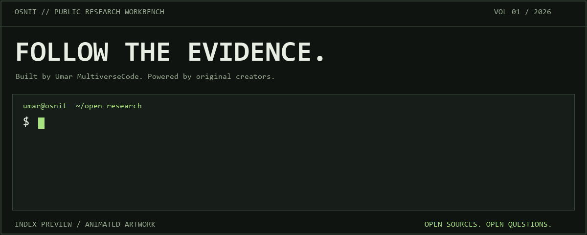
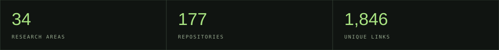
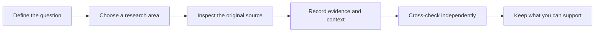

<p align="center">
  <picture>
    <source media="(prefers-reduced-motion: reduce)" srcset="assets/banner.svg">
    
  </picture>
</p>

<p align="center">
  <a href="https://github.com/Umar-MultiverseCode/OSNIT-TOOLS/actions/workflows/checks.yml"></a>
  <a href="https://github.com/Umar-MultiverseCode/OSNIT-TOOLS/stargazers"></a>
  <a href="https://github.com/Umar-MultiverseCode/OSNIT-TOOLS/forks"></a>
  <a href="https://github.com/Umar-MultiverseCode/OSNIT-TOOLS/issues"></a>
  <a href="https://github.com/Umar-MultiverseCode/OSNIT-TOOLS/commits/main"></a>
  <a href="LICENSE"></a>
</p>

<p align="center"><a href="#boot-sequence">BOOT</a> / <a href="#field-notes">FIELD NOTES</a> / <a href="#explore-the-directory">RESEARCH AREAS</a> / <a href="#deploy-the-workbench">DEPLOY</a> / <a href="CONTRIBUTING.md">CONTRIBUTE</a></p>

# OSNIT TOOLS

### Open sources. Sharp questions. Follow the evidence.

A public research workbench built and organized by **[Umar MultiverseCode](https://github.com/Umar-MultiverseCode)**. One place to discover tools, trace original sources and put together a toolkit that fits your question.

No account needed for this directory. No database. No trackers in the website. Just an organized index, an independently written interface and the people who built the tools behind it.

<p align="center"></p>

> **The organizer builds the workbench. The original creators build the tools.** Every repository entry preserves its creator, source and upstream license reference.

## Boot sequence

```sh
# Download this directory
 git clone https://github.com/Umar-MultiverseCode/OSNIT-TOOLS.git
 cd OSNIT-TOOLS

# Build and start the website -- Node.js 20 or newer
 npm run build
 npm run dev
```

Open **http://127.0.0.1:4173**. Press **/** to jump into search.

| Control | What it does |
| --- | --- |
| Keyword search | Find a tool, creator, source or research topic |
| Category + type filters | Narrow the collection without losing your direction |
| Field notes | Inspect original creator credits, source links and license status |
| Save + export | Build a private browser-local toolkit and download it as JSON |
| Grid / list | Choose a view that suits the way you work |
| Shareable filters | Send a category or search URL to someone else |

<details>
<summary><strong>GET A TOOL / download source without running unknown setup scripts</strong></summary>

```sh
node scripts/get-tool.mjs sherlock-project--sherlock
```

The source lands in the ignored `.local/tools` folder. Follow the **original project's README** for dependencies, operating-system support and configuration. Repository entries include software, guides and resource collections; a listing does not certify that a project is currently working.

</details>

## Field notes

A small discovery queue that rotates weekly. Follow a project back to its original author, read the documentation, then decide whether it fits your research.

<!-- FIELD-NOTES:START -->
**Week of 2026-09-28 · three original projects to explore**

| Project | Research direction | Creator |
| --- | --- | --- |
| [skytrack](docs/tools/ang13t--skytrack.md) | Flight & marine | [ANG13T](https://github.com/ANG13T) |
| [Telepathy](docs/tools/jordanwildon--telepathy.md) | Telegram | [jordanwildon](https://github.com/jordanwildon) |
| [h8mail](docs/tools/khast3x--h8mail.md) | Data Acquisition | [khast3x](https://github.com/khast3x) |

Open a field guide for the source, clone command and upstream license. This rotation highlights catalogue entries; it does not certify their availability or functionality.
<!-- FIELD-NOTES:END -->

<details>
<summary><strong>LIVE SYSTEMS / what actually updates</strong></summary>

- **Live GitHub badges** reflect workflow checks, stars, forks, open issues, the last commit and the website license. Values come from Shields.io and may be cached; they are not manually inflated.
- **Weekly field notes** rotate through three featured repository entries every Monday using the `Refresh README field notes` workflow. The workflow can also be run manually from GitHub Actions.
- **Catalogue metrics** are calculated from the JSON data during the same refresh, keeping the original metrics artwork in sync with the collection.
- **Animated terminal artwork** is an original looping illustration of the index. It is not a live scan. A static banner is included for reduced-motion rendering.

The scheduled refresh uses GitHub's normal workflow token. No extra API key or external account is required. GitHub may delay scheduled jobs, and branch protection can require maintainers to review generated changes. The refresh bot uses its own identity and real timestamps.

To refresh locally:

```sh
npm run readme:refresh
```

Only the generated field-notes section and `assets/catalog-metrics.svg` are changed.

</details>

## Work the question



A matching username is a lead, not proof of identity. A search result is a source to inspect, not a conclusion to copy.

## Explore the directory

Expand a collection to find its category guides. Individual guides link to the original tool documentation and license references.

<details open>
<summary><strong>Profiles, identities and communities</strong></summary>

- [Email & usernames](docs/categories/Email-Username-OSINT.md)
- [Social media](docs/categories/Social-Media-OSINT.md)
- [People search](docs/categories/People-Search-OSINT.md)
- [Telegram](docs/categories/Telegram-OSINT.md)
- [Telephone](docs/categories/Telephone-OSINT.md)
- [GitHub researchers](docs/categories/GitHub-OSINT-Accounts.md)
- [Communities & practitioners](docs/categories/OSINT-Communities-Practitioners.md)

</details>

<details>
<summary><strong>Visual research, location and transport</strong></summary>

- [Image research](docs/categories/Image-Research-OSINT.md)
- [Geolocation](docs/categories/Geolocation-OSINT.md)
- [YouTube & video](docs/categories/YouTube-Video-OSINT.md)
- [Flight & marine](docs/categories/Flight-And-Marine-OSINT.md)
- [Vehicle research](docs/categories/Vehicle-OSINT.md)
- [WiFi](docs/categories/WiFi-OSINT.md)
- [Fitness & leisure](docs/categories/Fitness-Leisure-OSINT.md)

</details>

<details>
<summary><strong>Search, records and the open web</strong></summary>

- [Search engines](docs/categories/Search-Engines.md)
- [Advanced searching](docs/categories/OSINT-Advanced-Searching.md)
- [Custom search engines](docs/categories/Custom-Search-Engines.md)
- [Website research](docs/categories/Website-OSINT.md)
- [Internet research](docs/categories/Internet-OSINT.md)
- [Archives](docs/categories/Archive-OSINT.md)
- [Data acquisition](docs/categories/Data-Acquisition-OSINT.md)
- [Companies & business](docs/categories/Company-Business-OSINT.md)
- [Ancestry & genealogy](docs/categories/Ancestry-Genealogy-OSINT.md)
- [URL manipulation](docs/categories/URL-Manipulation.md)
- [Fact-checking & verification](docs/categories/Fact-Checking-Verification.md)
- [Darkweb research](docs/categories/Darkweb-OSINT.md)

</details>

<details>
<summary><strong>Privacy, supporting tools and learning</strong></summary>

- [Privacy & infosec](docs/categories/Privacy-Infosec-Tools-Resources.md)
- [Privacy practitioners](docs/categories/Privacy-Practitioners.md)
- [Privacy opt-out](docs/categories/Privacy-Opt-Out.md)
- [VPN providers](docs/categories/VPN-Providers.md)
- [Research utilities](docs/categories/OSINT-Toolbox-Peripherals.md)
- [Browser extensions](docs/categories/OSINT-Browser-Extensions.md)
- [Blogs & learning](docs/categories/OSINT-Blogs-Video-Resources.md)
- [AI resources](docs/categories/AI-Resources.md)

</details>

## Deploy the workbench

<p><a href="https://vercel.com/new/clone?repository-url=https%3A%2F%2Fgithub.com%2FUmar-MultiverseCode%2FOSNIT-TOOLS"></a></p>

| Vercel setting | Value |
| --- | --- |
| Root Directory | `.` -- repository root |
| Framework Preset | `Other` |
| Build Command | `npm run build` |
| Output Directory | `dist` |
| Environment variables | None required |

The included `vercel.json` handles the build settings. After deployment, Vercel gives you the live URL. Interactive search and saved toolkits run on the website; GitHub renders the expandable collections, diagrams and image badges in this README.

## Inside the workbench

```text
OSNIT-TOOLS/
+-- web/                    Interface and client-side filters
+-- data/
|   +-- categories.json     Research areas and collection credits
|   +-- resources.json      Deduplicated source links
|   +-- tools/              One original-project manifest per repository
+-- docs/
|   +-- categories/         Category field guides
|   +-- tools/              Creator credits, clone commands and license references
+-- assets/                 Original terminal artwork and catalogue metrics
+-- scripts/                Build, preview, download and README refresh helpers
+-- tests/                  Catalogue integrity and filtering checks
+-- .github/workflows/      Directory checks and weekly field-note rotation
```

<details>
<summary><strong>MAINTAINER CHECKLIST / before a pull request</strong></summary>

```sh
npm test
npm run readme:refresh
npm run build
npm run dev
```

Check creator credit, the original URL, category IDs and the upstream license reference. For interface changes, check search, saved entries, keyboard access and mobile layout. Keep the rectangular design intact.

The website has **zero third-party npm dependencies**. README badges use external image services; saved website resources stay in the reader's browser.

</details>

## Build with us

| Your next move | Start here |
| --- | --- |
| Add a useful source | [Suggest a resource](https://github.com/Umar-MultiverseCode/OSNIT-TOOLS/issues/new?template=resource.yml) |
| Found a dead link | [Report a broken link](https://github.com/Umar-MultiverseCode/OSNIT-TOOLS/issues/new?template=broken-link.yml) |
| Improve the directory | [Contribution guide](CONTRIBUTING.md) |
| Inspect original credits | [Attribution and license boundaries](ATTRIBUTION.md) |

**A star helps people discover the directory. A well-sourced contribution makes it better.**

## Credits and licenses

The starting collection is credited to **[The OSINT Toolbox](https://github.com/The-Osint-Toolbox)**. Listed projects belong to their original authors. The website and original documentation use the [MIT license](LICENSE); linked projects retain their own upstream terms. Missing or unverified licenses remain labeled explicitly.

Live badge infrastructure comes from [Shields.io](https://github.com/badges/shields). GitHub Actions drives the weekly refresh; Mermaid renders the research flow. Terminal artwork and metrics graphics are original assets created for this project. See [ATTRIBUTION.md](ATTRIBUTION.md).

---

<p align="center"><strong>BUILD IN THE OPEN. FOLLOW THE EVIDENCE. KEEP LOOKING.</strong><br><sub>Organized by Umar MultiverseCode / OSNIT TOOLS</sub></p>
